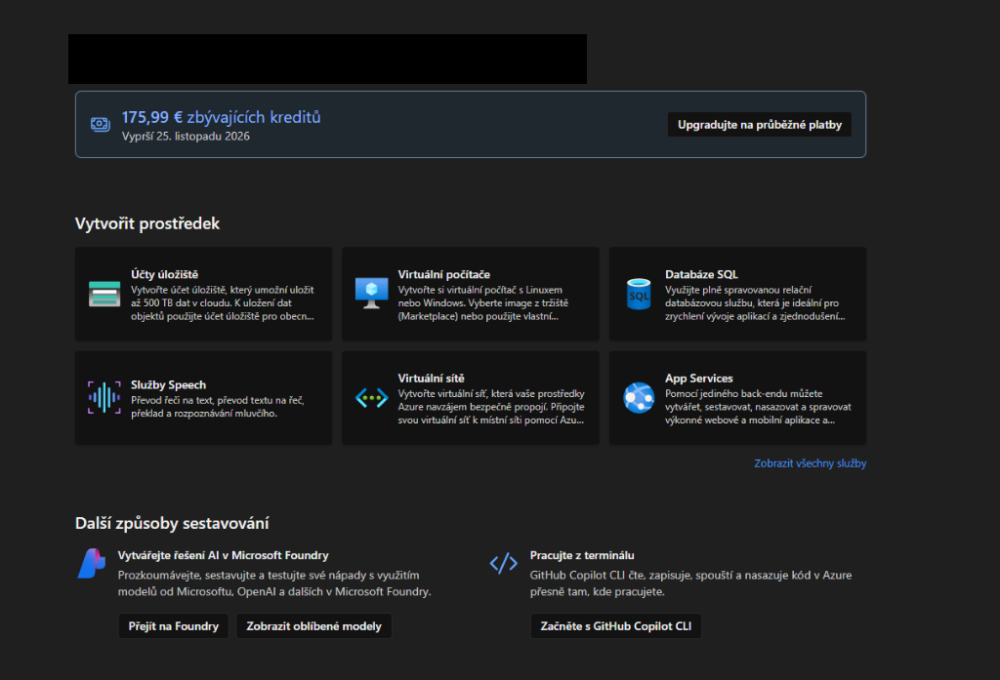
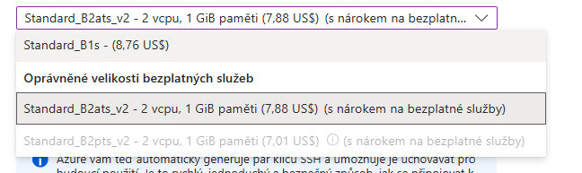
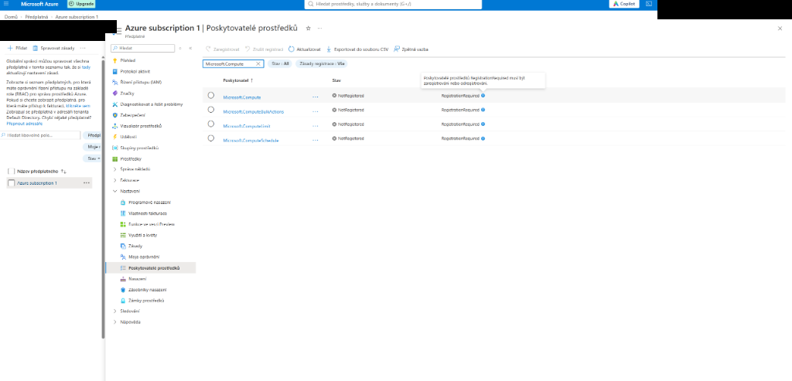
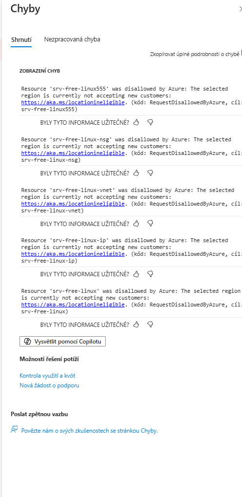
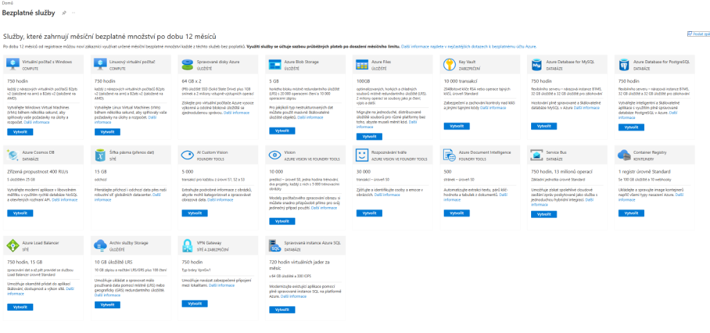
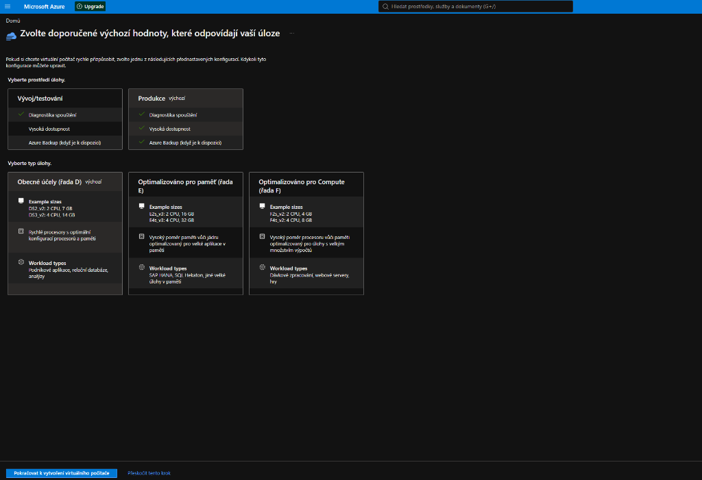
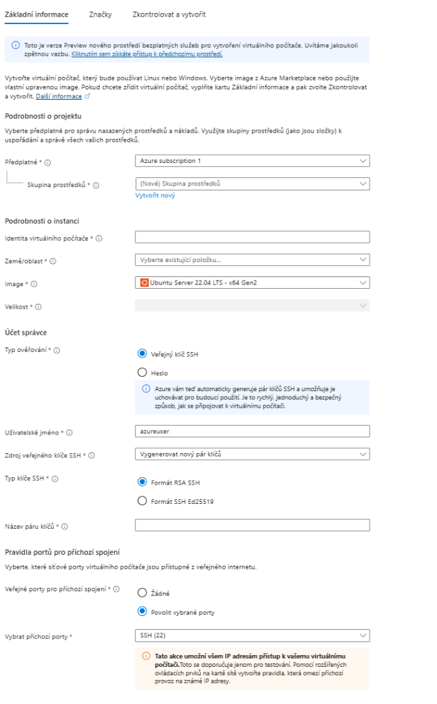
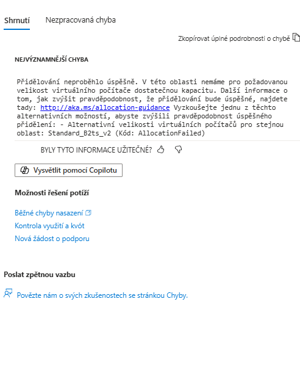
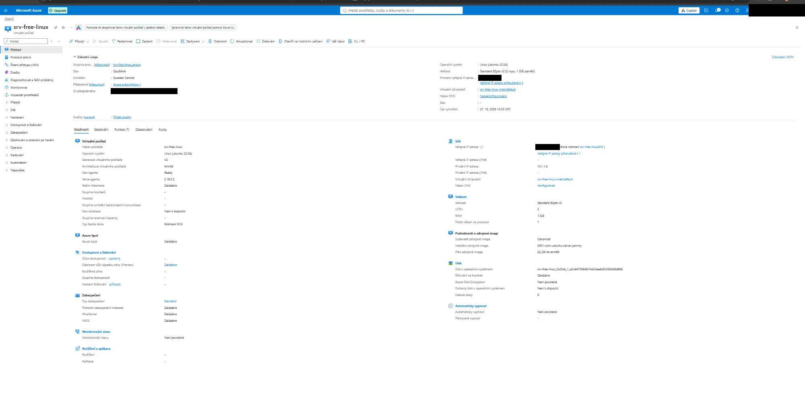

# Azure Free Tier – Linux server zdarma na 12 měsíců

> Ověřeno v praxi (10/2026, český účet). Jen odrážky, jen podstata.

---

## 1. Tarify

* **Azure for Students** – [azure.microsoft.com/free/students](https://azure.microsoft.com/free/students/)
  * Bez karty.
  * 100 USD **na rok** (ne měsíčně), obnova po re-verifikaci školního mailu.
  * Vyčerpání = služby se zastaví, nic se nestrhne.
* **Free Trial** – [azure.microsoft.com/free](https://azure.microsoft.com/free)
  * Karta povinná (jen ověření, 0 Kč).
  * 200 USD (~176 €) na 30 dní.
  * 12 měsíců zdarma: 750 h Linux VM, 2× 64 GB P6 SSD, 15 GB odchozích dat/měsíc.
  * NEklikat **Upgrade / Průběžné platby** (až těsně před koncem 30 dní).



---

## 2. Co získáš (parametry)

* **Kredit:** 200 USD (~176 €) na 30 dní – na cokoliv placeného.
* **Server (VM) – 12 měsíců, 750 h/měsíc = 1 server nonstop:**
  * Velikost: `Standard_B2pts_v2` (ARM64) nebo `Standard_B2ats_v2` (x64, AMD).
  * CPU: 2 vCPU, burstable (plný výkon jen nárazově).
  * RAM: 1 GB (reálně ~950 MB pro systém → nutný swap).
  * OS: libovolný Linux (Ubuntu 22.04/24.04), plný root (`sudo`).
  * Výkon disků VM: max 3 750 IOPS, 85 MB/s, až 4 datové disky.
  * Síť: 1 veřejná IPv4, přístup přes SSH.
* **Disky – 12 měsíců:**
  * 2× 64 GB Premium SSD (P6) – 1 na systém, 1 volný na data.
  * P6: 240 IOPS, 50 MB/s (krátkodobě burst víc).
  * Reálně po instalaci Ubuntu: ~61 GB volných.
* **Přenos dat:** 15 GB odchozích/měsíc (příchozí vždy zdarma).
* **Další služby zdarma 12 měsíců** (dle stránky Bezplatné služby):
  * Windows VM: 750 h (B2pts v2 / B2ats v2).
  * MySQL Flexible Server: 750 h (B1MS) + 32 GB úložiště + 32 GB zálohy.
  * PostgreSQL Flexible Server: 750 h (B1MS) + 32 GB úložiště + 32 GB zálohy.
  * Cosmos DB: 400 RU/s + 25 GB.
  * Blob Storage: 5 GB (LRS hot).
  * Azure Files: 100 GB.
  * Archive Storage: 10 GB.
  * Container Registry: 1× Standard (100 GB, 10 webhooků).
  * Key Vault: 10 000 transakcí.
  * Service Bus: 750 h, 13 mil. operací.
  * Load Balancer: 750 h, 15 GB zpracovaných dat.
  * VPN Gateway: 750 h (VpnGw1).
  * SQL Managed Instance: 720 vCore hodin/měsíc.
  * AI: Custom Vision 5 000 transakcí, Vision 10 000, Face 30 000, Document Intelligence 500 stránek.
* **Limit vCPU:** 4 vCPU na region (trial kvóta).

---

## 3. Co je opravdu zdarma

* VM: **`Standard_B2ats_v2`** (x64, AMD) nebo **`Standard_B2pts_v2`** (ARM).
  * 2 vCPU, 1 GB RAM.
  * Ve výběru velikosti musí být štítek **„s nárokem na bezplatné služby“**.
* NE `B1s` – stará řada, už bez štítku.
* NE `B2ts_v2` – Azure ji nabízí při chybě, **ale je placená**.
* Disk: **64 GB Premium SSD (P6)**.



---

## 4. Než začneš: registrace Microsoft.Compute

* Bez toho hlásí **`NotAvailableForSubscription`** všude.
* [Předplatná](https://portal.azure.com/#view/Microsoft_Azure_Billing/SubscriptionsBlade) → *Azure subscription 1* → **Poskytovatelé prostředků**.
* Najít `Microsoft.Compute` → **Zaregistrovat** → počkat na **Registered**.



---

## 5. Region

* Většina EU regionů je pro trial **zablokovaná**:
  * North Europe, West Europe, Germany, France, UK, Norway, Poland, Switzerland, Italy.
* ANO: **Sweden Central** (B2ats_v2 i B2pts_v2).
* Záloha: Spain Central, Austria East, Belgium Central, Denmark East (jen B2ats_v2).
* East US = zakázané pro EU účet.
* Seznam pro **tvůj** účet (Cloud Shell nebo Azure CLI):

```bash
az vm list-skus --all --resource-type virtualMachines \
  --query "[?(name=='Standard_B2ats_v2' || name=='Standard_B2pts_v2') && length(restrictions[?type=='Location'])==\`0\`].[locations[0], name]" -o table
```



---

## 6. Vytvoření VM – portál

* Přímý odkaz: [Bezplatné služby](https://portal.azure.com/#blade/Microsoft_Azure_Billing/FreeServicesBlade)
  * NE přes „Virtuální počítače → Vytvořit“ – tlačí placené řady D/E/F (případně **Přeskočit tento krok**).




* Dlaždice **Linuxový virtuální počítač** → **Vytvořit**.
* Vyplnit:
  * Skupina prostředků: nová (1 projekt = 1 skupina).
  * Oblast: **Sweden Central** (v roletce může být schovaná pod „Jiné“).
  * Image: Ubuntu 22.04 – **x64** pro B2ats_v2, **ARM64** pro B2pts_v2.
  * Velikost: se štítkem „s nárokem“.
  * Ověření: **SSH klíč** → při vytvoření **stáhnout `.pem`** (jen jednou!).
  * Porty: jen **SSH (22)**.
* Disky průvodce nastaví sám (64 GB P6).



---

## 7. Vytvoření VM – CLI (rychlejší, žádné klikání)

* Instalace (Windows): `winget install -e --id Microsoft.AzureCLI`
* Přihlášení: `az login --use-device-code` → kód zadat na [login.microsoft.com/device](https://login.microsoft.com/device)
  * Kód vypíše CLI v terminálu, nechodí mailem.

```bash
az group create -n rg-free -l swedencentral
az vm create -g rg-free -n srv-free -l swedencentral \
  --size Standard_B2pts_v2 \
  --image Canonical:0001-com-ubuntu-server-jammy:22_04-lts-arm64:latest \
  --admin-username azureuser --generate-ssh-keys \
  --os-disk-size-gb 64 --storage-sku Premium_LRS --security-type Standard
```

* x64 varianta: `--size Standard_B2ats_v2 --image Ubuntu2204`.
* Klíč se uloží do `~/.ssh/id_rsa` – zálohovat.

---

## 8. Chyba `AllocationFailed`

* = Microsoftu v regionu došel hardware. **Nastavení je OK.**
* Vysvětlení: [aka.ms/allocation-guidance](http://aka.ms/allocation-guidance)
* Řešení:
  * Zkusit znovu později (`az vm start`).
  * Nebo druhá free velikost (x64 ⇄ ARM) – **ARM musí mít ARM64 image**.
  * Nebo jiný povolený region.
* NE `B2ts_v2`, i když ji chyba doporučuje.



* Příbuzná chyba `RequestDisallowedByAzure` („region is not accepting new customers“): [aka.ms/locationineligible](https://aka.ms/locationineligible) → jiný region.

---

## 9. Hotovo – kontrola

* [Virtuální počítače](https://portal.azure.com/#browse/Microsoft.Compute%2FVirtualMachines) → název serveru → **Přehled**.
* Stav: **Spuštěné**.
* Velikost: B2pts v2 / B2ats v2.
* Azure Spot: Zakázáno.
* Monitorování, zálohování: vypnuté.
* Porty: server → **Sítě** (otevírat 80/443 až pro web).
* Připojení:

```bash
ssh -i cesta/ke/klici.pem azureuser@<veřejná-IP>
```



---

## 10. SWAP (nutné pro 1 GB RAM)

```bash
sudo fallocate -l 2G /swapfile
sudo chmod 600 /swapfile
sudo mkswap /swapfile
sudo swapon /swapfile
echo '/swapfile none swap sw 0 0' | sudo tee -a /etc/fstab
echo 'vm.swappiness=10' | sudo tee -a /etc/sysctl.conf
sudo sysctl -p
```

---

## 11. Pasti na peníze

* **Jen 1 VM nonstop** – 750 h = 1 server celý měsíc. Dva = půlka měsíce placená.
* **Vypínat v portálu** (tlačítko Zastavit = *deallocated*). `sudo poweroff` = hodiny běží dál.
* **Mazat celou skupinu prostředků** – smazání VM nechá disk a IP (placené).
* **Nepřipojená veřejná IP** = ~3–4 $/měsíc.
* **Placené doplňky** – Backup, Defender, Bastion (140 $/měsíc), Monitoring: nezapínat.
* **Burstable CPU** – nízký základní výkon, nad něj čerpá kredity; dlouhá zátěž = přiškrcení.
* **Po 30 dnech** – trial se zmrazí, VM se zastaví. Pro 12 měsíců zdarma nutný upgrade na průběžné platby (free kvóty platí dál).

---

## 12. Záchranná brzda: rozpočet 1 $

* [Cost Management](https://portal.azure.com/#view/Microsoft_Azure_CostManagement/Menu/~/overview) → **Budgets** → **+ Add**.
* Částka: **1**.
* Upozornění: 50 % a 100 %.
* Příjemce: svůj e-mail.
* Po pár dnech zkontrolovat **Analýza nákladů** – musí být 0.

---

## 13. Všechny odkazy

* Registrace:
  * Free Trial: [azure.microsoft.com/free](https://azure.microsoft.com/free)
  * Studenti: [azure.microsoft.com/free/students](https://azure.microsoft.com/free/students/)
* Portál:
  * Domů: [portal.azure.com](https://portal.azure.com)
  * Bezplatné služby: [FreeServicesBlade](https://portal.azure.com/#blade/Microsoft_Azure_Billing/FreeServicesBlade)
  * Předplatná (Microsoft.Compute): [SubscriptionsBlade](https://portal.azure.com/#view/Microsoft_Azure_Billing/SubscriptionsBlade)
  * Virtuální počítače: [VirtualMachines](https://portal.azure.com/#browse/Microsoft.Compute%2FVirtualMachines)
  * Cost Management: [Přehled nákladů](https://portal.azure.com/#view/Microsoft_Azure_CostManagement/Menu/~/overview)
* CLI přihlášení kódem: [login.microsoft.com/device](https://login.microsoft.com/device)
* Chyby:
  * AllocationFailed: [aka.ms/allocation-guidance](http://aka.ms/allocation-guidance)
  * Region nepřijímá zákazníky: [aka.ms/locationineligible](https://aka.ms/locationineligible)
* Tento návod: [github.com/MonsterMarian/FreeRam](https://github.com/MonsterMarian/FreeRam)
* Přímé odkazy na konkrétní server (s ID předplatného) sem nepatří – repo je veřejné.
